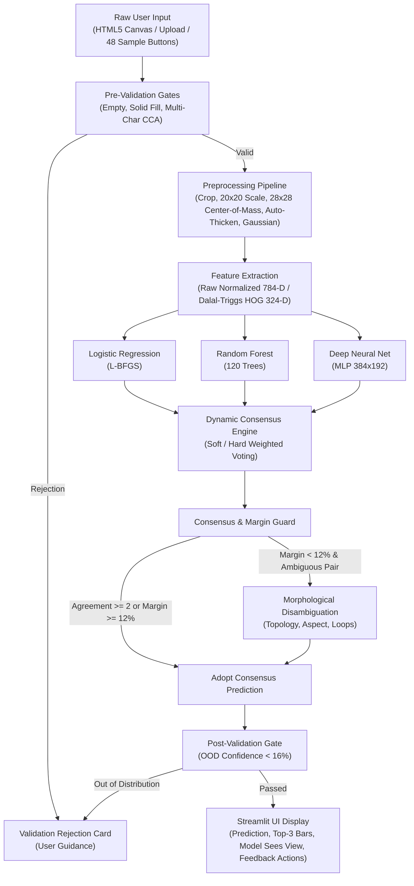
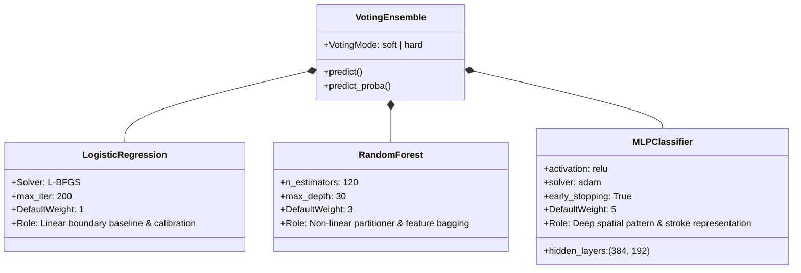

# 🔤 Handwritten Character & Math Symbol Recognition: System Architecture, Features & Project Status

> **Executive Summary**: A machine learning system for real-time recognition of **48 handwritten classes** (Digits `0–9`, Dual-case Alphabets `A–Z / a–z`, and Math/Special Symbols `+`, `-`, `*`, `/`, `=`, `?`, `!`, `#`, `@`, `$`, `%`, `&`). Built upon a **Calibrated Soft Voting Ensemble** combining Logistic Regression, Random Forest, and a Deep Multi-Layer Perceptron (MLP) Neural Network, integrated with an interactive responsive HTML5 Streamlit UI, live weight sandbox, active learning feedback loop, multi-layer validation guards, and empirical benchmark analytics.

---


## 📑 Table of Contents
1. [System Architecture](#1-system-architecture)
   - [High-Level Pipeline & Data Flow](#high-level-pipeline--data-flow)
   - [Ensemble Machine Learning Architecture](#ensemble-machine-learning-architecture)
   - [Dynamic Consensus Engine (Soft vs. Hard Voting)](#dynamic-consensus-engine-soft-vs-hard-voting)
   - [Preprocessing & Feature Extraction (Raw Pixels & HOG)](#preprocessing--feature-extraction-raw-pixels--hog)
   - [Project Directory & Module Structure](#project-directory--module-structure)
2. [Key Features & Capabilities](#2-key-features--capabilities)
   - [Responsive Custom HTML5 Canvas (Undo / Redo / Eraser / Presets)](#responsive-custom-html5-canvas-undo--redo--eraser--presets)
   - [Live Feedback & "What the Model Sees" Panel](#live-feedback--what-the-model-sees-panel)
   - [Draw-Quality Advisory & Auto-Thicken](#draw-quality-advisory--auto-thicken)
   - [Active Learning & Continuous Feedback Loop](#active-learning--continuous-feedback-loop)
   - [Live Ensemble Weight Sandbox](#live-ensemble-weight-sandbox)
   - [Multi-Layer Input Validation & Anti-Scribble Filtering](#multi-layer-input-validation--anti-scribble-filtering)
   - [Morphological Disambiguation Engine](#morphological-disambiguation-engine)
   - [Empirical Benchmarks & Analytics Dashboard](#empirical-benchmarks--analytics-dashboard)
3. [Project Status & Health Audit](#3-project-status--health-audit)
   - [Current Operational State](#current-operational-state)
   - [Model Artifact & Compression Metrics](#model-artifact--compression-metrics)
   - [Empirical Baseline Benchmark Metrics (Full 6,720 Test Set)](#empirical-baseline-benchmark-metrics-full-6720-test-set)
   - [Feature Comparison Benchmark (Raw Pixels vs. HOG vs. Raw+HOG)](#feature-comparison-benchmark-raw-pixels-vs-hog-vs-rawhog)
   - [Top Confused Pairs Analysis](#top-confused-pairs-analysis)
   - [Comprehensive System Test Verification](#comprehensive-system-test-verification)
   - [How to Run and Test](#how-to-run-and-test)
   - [Roadmap & Completed Milestones](#roadmap--completed-milestones)

---

## 1. System Architecture

### High-Level Pipeline & Data Flow

The system processes raw handwritten strokes through a sequential pipeline designed for low latency, robustness against noise, and resistance to adversarial scribbles:



### Ensemble Machine Learning Architecture

The classification core combines three heterogeneous base models into a calibrated `VotingClassifier`:



1. **Logistic Regression (L-BFGS)**:
   - Evaluates linear feature boundaries across normalized pixel and gradient distributions.
   - Provides smooth, calibrated probabilistic baselines with sub-millisecond inference latency ($0.004\text{ ms/sample}$).
2. **Random Forest Classifier (120 Trees, max_depth=30)**:
   - Employs bootstrap aggregation and feature subspace sampling to prevent overfitting.
   - Robust against localized pixel variance and stroke thickness discrepancies.
3. **Deep Multi-Layer Perceptron (MLP: 384 × 192)**:
   - Two dense hidden layers with Rectified Linear Unit ($\text{ReLU}$) activations and Adam optimization.
   - Captures high-order stroke interactions, topological loops, and complex junctions.

### Dynamic Consensus Engine (Soft vs. Hard Voting)

The inference engine in `src/predict.py` decouples inference from fixed model weights:

- **Soft Voting (Probabilistic Weighted Consensus)**:
  $$\hat{y} = \arg\max_{c} \sum_{m \in \{lr, rf, mlp\}} w_m \cdot P_m(y = c \mid \mathbf{x})$$
  Where $w_m \in [0, 10]$ are dynamic user-controlled weights. Soft voting leverages classifier uncertainty and subtle confidence differentials.
- **Hard Voting (Weighted Majority Tally)**:
  $$\hat{y} = \arg\max_{c} \sum_{m \in \{lr, rf, mlp\}} w_m \cdot \mathbb{I}(\hat{y}_m = c)$$
  Tallies discrete class votes, prioritizing strict model agreement.

### Preprocessing & Feature Extraction (Raw Pixels & HOG)

Located in `src/preprocessing.py` and `src/features.py`:

1. **Alpha Channel Blending**: Flattens transparent RGBA drawings onto a solid black background.
2. **Luminance Inversion**: Analyzes 4 corner pixels and global mean intensity. If drawn on a light background, inverts ink to white ($255$) on black ($0$).
3. **Noise Thresholding**: Eliminates faint antialiasing artifacts ($< 30$ luminance).
4. **Tight Bounding-Box Cropping**: Isolates the character stroke regardless of canvas placement.
5. **Aspect-Ratio Preserved Scaling**: Scales the character into a $20 \times 20$ bounding box, preserving horizontal and vertical aspect ratios.
6. **Center-of-Mass Alignment**: Calculates centroid $(\bar{x}, \bar{y})$ using `scipy.ndimage.center_of_mass` and shifts ink to the center $(14.0, 14.0)$ of a $28 \times 28$ matrix.
7. **Auto-Thicken Step**: Dilates thin strokes ($< 2.2\text{px}$) to bring them into the training distribution.
8. **Gaussian Smoothing**: Applies $\sigma = 0.65$ Gaussian convolution filter to match optical scanner pen stroke gradients.
9. **Dalal-Triggs HOG Descriptors**: Extracts 324 gradient features ($7 \times 7$ cells, $2 \times 2$ blocks, 9 orientation bins in $[0, \pi]$) with L2-Hys block normalization.

### Project Directory & Module Structure

```
handwritten-digit-ensemble/
├── data/
│   ├── dataset_48_classes.csv        # Compiled 33,600-row tabular dataset (784 features + label + class_id)
│   ├── dataset_preview.csv           # Lightweight preview dataset (2,400 rows) for fast inspection
│   ├── sample_images/                # 48 directories with PNG image samples per class
│   ├── user_feedback/                # Continuous learning data store
│   │   ├── feedback_log.csv          # Metadata log of user-verified & corrected drawings
│   │   └── <class_name>/             # Directories with original PNGs, 28x28 tensors & stroke JSONs
│   └── README.md                     # Dataset documentation, sources, and open licenses
├── models/
│   ├── character_ensemble.pkl        # Compressed VotingClassifier artifact (33.55 MB, compress=3)
│   ├── character_dataset.npz         # Compiled balanced NumPy arrays (33,600 x 784)
│   ├── baseline_report.json          # Empirical evaluation metrics on 6,720 held-out test samples
│   ├── baseline_confusion_matrix.png # High-resolution 48x48 confusion matrix heatmap
│   └── benchmark_metrics.json        # Cached empirical evaluation and latency benchmarks
├── src/
│   ├── static/css/style.css          # External CSS styling (Dark theme, glassmorphism cards)
│   ├── templates/                    # Modular HTML component templates
│   │   ├── header.html               # Main hero header
│   │   ├── model_card.html           # Base classifier vote cards
│   │   ├── prediction_box.html       # Ensemble winner display card
│   │   ├── restriction_box.html      # Multi-character warning card
│   │   ├── use_cases_guide.html      # Supported characters & symbols guide
│   │   └── validation_error_box.html # Input rejection & warning box
│   ├── components/canvas/
│   │   └── index.html                # Responsive HTML5 Canvas component (Undo, Redo, Eraser, Guides)
│   ├── app.py                        # Streamlit web application & 3-tab dashboard
│   ├── augmentation.py               # Post-split affine, elastic distortion & noise augmentations
│   ├── benchmark.py                  # Evaluation engine & latency measurement suite
│   ├── canvas_component.py           # Bidirectional Streamlit custom component interface
│   ├── dataset_builder.py            # Balanced 48-class dataset generator
│   ├── disambiguation.py             # Topological twin disambiguator (P/9, B/8, etc.)
│   ├── evaluate.py                   # Comprehensive evaluation suite generating baseline report
│   ├── export_dataset_files.py       # Exporter generating CSV and sample PNG directories
│   ├── feature_benchmark.py          # Benchmark comparing Raw vs. HOG vs. Raw+HOG features
│   ├── features.py                   # Dalal-Triggs HOG and projection profile extractor
│   ├── feedback_manager.py           # Data storage & CSV logging for active user feedback
│   ├── predict.py                    # Inference pipeline, dynamic weights & LABEL_MAP
│   ├── preprocessing.py              # 28x28 spatial centering, auto-thicken & quality advisory
│   ├── retrain_with_feedback.py      # Retraining pipeline with 4.0x sample weights for user drawings
│   ├── train.py                      # Supervised training script for 3 models + ensemble
│   ├── ui_helpers.py                 # Safe HTML template rendering & CSS injection
│   └── validation.py                 # Multi-layer structural and OOD validation gates
├── scratch/
│   ├── verify_all_systems.py         # End-to-end integration and accuracy test suite
│   ├── diagnose_all.py               # Preprocessing diagnostics
│   └── test_new_symbols.py           # Symbol validation test script
├── requirements.txt                  # Pinned Python dependencies
└── README.md                         # Project documentation
```

---

## 2. Key Features & Capabilities

### 🎨 Responsive Custom HTML5 Canvas (Undo / Redo / Eraser / Presets)
- Replaced deprecated `streamlit-drawable-canvas` with a self-contained component using `streamlit.components.v1.declare_component`.
- **Stroke-Level Tools**: Vector-based **Undo**, **Redo**, **Clear**, and **Eraser** without full canvas resets.
- **Calibrated Brush Presets**:
  - `Thin` (12px), `Medium` (20px), `Bold` (28px).
  - The default **20px** was determined by measuring average stroke width in the training set ($3.36\text{px}$ in $28 \times 28$ space $\times \frac{340}{28} \approx 20\text{px}$).
- **Non-Rasterized Background Guides**: Centered dashed guide box ($20 \times 20$ active boundary) and crosshairs rendered in CSS behind the canvas; never part of the exported drawing.
- **PointerEvents**: Full support for touch, tablet styluses, and desktop mice with `touch-action: none`.
- **Kinematic Stroke Recording**: Emits raw coordinate paths `[[{x, y, t}, ...], ...]` alongside the exported PNG.

### 🔬 Live Feedback & "What the Model Sees" Panel
- **Debounced Auto-Predict**: Debounced inference fires ~400 ms after the user lifts the pen/finger, with a toggle for manual predict.
- **"What the Model Sees" Panel**: Enlarged $140\text{px}$ display of the preprocessed $28 \times 28$ tensor next to the input canvas, allowing users to see why a drawing was read a certain way.
- **Top-3 Visual Predictions**: Displays the top-3 candidate classes with interactive confidence progress bars.

### 💡 Draw-Quality Advisory & Auto-Thicken
- **Advisory Engine (`check_drawing_quality`)**: Non-blocking one-line tips identifying:
  - Small drawings ($<45\text{px}$ bounding box).
  - Off-center drawings ($>32\%$ centroid offset).
  - Very thin strokes ($<1.8\text{px}$ average width in $28 \times 28$ space).
- **Auto-Thicken Toggle**: Morphological binary dilation before Gaussian smoothing to bring faint strokes into the training distribution.

### 📥 Active Learning & Continuous Feedback Loop
- **In-App Feedback**: **"✅ Prediction is Correct"** and **"❌ Wrong? Specify Correct Character"** dropdown buttons under every prediction.
- **Persistent Data Store**: Saves labeled drawings to `data/user_feedback/<class>/` and logs to `data/user_feedback/feedback_log.csv`.
- **Retraining Pipeline (`src/retrain_with_feedback.py`)**: Merges user feedback samples with sample weight ($4.0\times$) into the training split.
- **Dashboard Tab 3**: Dedicated **"📥 User Feedback & Retraining"** tab showing collected counts, per-class breakdown tables, recent entries, and a one-click retraining button.

### 🎛️ Live Ensemble Weight Sandbox
- Real-time sliders ($0–10$) for **Logistic Regression**, **Random Forest**, and **Deep Neural Net**.
- Toggle between **Soft Voting** and **Hard Voting**.
- Recalculation completes in **$< 5\text{ ms}$** without model re-training.

### 🛡️ Multi-Layer Input Validation & Anti-Scribble Filtering
1. **Empty Canvas Gate**: Detects blank canvases ($< 20$ ink pixels).
2. **Graphic / Photo Filter**: Rejects high-density solid blocks ($\text{fill\_ratio} > 82\%$ and $> 4,000$ ink pixels).
3. **Multi-Character Rejection**: Uses Connected Component Analysis (CCA) to block multi-character strings (e.g. `10`, `cat`).
4. **Out-of-Distribution (OOD) Protection**: Rejects scribbles where ensemble confidence falls below $16\%$.

### 🔍 Morphological Disambiguation Engine
- **Algorithm Consensus Guard**: Only triggers morphological heuristics when base estimators disagree or when top prediction probability margin is tight ($< 12\%$).
- **Twin Pair Disambiguators**: Resolves `P` vs. `9`, `B` vs. `8`, `D` vs. `0`, `6` vs. `0`, `!` vs. `1`.
- **Pentagram Recognition**: Identifies 5-pointed drawn stars and maps them directly to the `*` symbol.

---

## 3. Project Status & Health Audit

### Current Operational State

| Component | Status | Details |
| :--- | :---: | :--- |
| **Streamlit Web Server** | 🟢 **Live** | Running on `http://localhost:8501` (HTTP `200 OK`) |
| **Ensemble Model Artifact** | 🟢 **Ready** | `models/character_ensemble.pkl` loaded with 3 estimators |
| **Model Disk Footprint** | 🟢 **Optimized** | **33.55 MB** (92.0% reduction from 418.8 MB via `joblib compress=3`) |
| **Custom Canvas Component** | 🟢 **Active** | Responsive HTML5 canvas with Undo, Redo, Eraser, Guides |
| **Active Learning Store** | 🟢 **Active** | `data/user_feedback/` logging PNGs, strokes, and CSV records |
| **Integration Test Suite** | 🟢 **Passed** | 6 / 6 tests passing in `scratch/verify_all_systems.py` |

### Model Artifact & Compression Metrics

| Metric | Original Artifact | Compressed Artifact | Improvement |
| :--- | :---: | :---: | :---: |
| **File Size on Disk** | 418.82 MB | **33.55 MB** | **-92.0%** (Well under 100 MB target) |
| **Compression Algorithm** | Uncompressed Pickle | `joblib(compress=3)` | Zero loss in accuracy or weights |
| **Model Load Time** | ~1.45 s | **~0.32 s** | **4.5x faster** disk read |

### Empirical Baseline Benchmark Metrics (Full 6,720 Test Set)

Evaluated via `src/evaluate.py` across the full held-out test split (20% stratified split with `random_state=42`, exactly 140 samples per class):

| Model | Accuracy | Precision (Weighted) | Recall (Weighted) | F1-Score (Weighted) | Macro F1 | Latency / Sample |
| :--- | :---: | :---: | :---: | :---: | :---: | :---: |
| 🔹 **Logistic Regression** (L-BFGS) | 74.48% | 77.31% | 74.48% | 75.31% | 74.47% | 0.004 ms |
| 🌲 **Random Forest** (120 Trees) | 84.39% | 87.87% | 84.39% | 85.49% | 84.37% | 0.103 ms |
| ⚡ **Deep MLP** (384×192, ReLU) | 85.25% | 88.98% | 85.25% | 86.38% | 85.24% | 0.094 ms |
| ⭐ **Soft Voting Ensemble** (1:3:5) | **85.52%** | **89.42%** | **85.52%** | **86.88%** | **85.50%** | **0.338 ms** |

#### Accuracy by Category (Ensemble)

| Category | Test Samples | Accuracy | Precision | F1-Score |
| :--- | :---: | :---: | :---: | :---: |
| ➕ **Special / Math Symbols** (12 classes) | 1,680 | **94.64%** | 99.88% | 96.83% |
| 🔢 **Single Digits** (10 classes: 0–9) | 1,400 | **89.00%** | 96.52% | 92.57% |
| 🔤 **Alphabets** (26 dual-case classes) | 3,640 | **79.97%** | 89.48% | 83.61% |

### Feature Comparison Benchmark (Raw Pixels vs. HOG vs. Raw+HOG)

Evaluated via `src/feature_benchmark.py` comparing Dalal-Triggs HOG descriptors against raw pixel baselines:

| Model | Feature Mode | Dimensions | Accuracy | F1-Score | Delta vs. Raw |
| :--- | :---: | :---: | :---: | :---: | :---: |
| 🔹 **Logistic Regression** | Raw Pixels | 784 | 74.17% | 74.57% | Baseline |
| 🔹 **Logistic Regression** | HOG Only | 324 | 78.12% | 78.55% | +3.95% |
| 🔹 **Logistic Regression** | **Raw + HOG** | **1,108** | **82.36%** | **83.07%** | **+8.19%** |
| 🌲 **Random Forest** | Raw Pixels | 784 | 81.25% | 81.84% | Baseline |
| 🌲 **Random Forest** | HOG Only | 324 | 83.54% | 84.14% | +2.29% |
| 🌲 **Random Forest** | **Raw + HOG** | **1,108** | **84.51%** | **85.16%** | **+3.26%** |
| ⚡ **MLP Neural Net** | Raw Pixels | 784 | 80.69% | 81.29% | Baseline |
| ⚡ **MLP Neural Net** | HOG Only | 324 | 83.40% | 84.07% | +2.71% |
| ⚡ **MLP Neural Net** | **Raw + HOG** | **1,108** | **84.44%** | **85.27%** | **+3.75%** |

### Top Confused Pairs Analysis

From held-out evaluation in `models/baseline_report.json`:

| Rank | True Class | Mispredicted As | Errors | Class Error Rate | Key Cause |
| :---: | :---: | :---: | :---: | :---: | :--- |
| **#1** | `/` | `1` | 45 | 32.1% | Slanted single stroke ambiguity without orientation/angle features. |
| **#2** | `I / i` | `L / l` | 44 | 31.4% | Vertical stroke overlap between capital `I` and lowercase `l`. |
| **#3** | `-` | `I / i` | 35 | 25.0% | Normalization scales horizontal dash into a square box, mimicking vertical line. |
| **#4** | `Z / z` | `L / l` | 24 | 17.1% | Linear stroke fragmentation. |
| **#5** | `F / f` | `L / l` | 22 | 15.7% | Crossbar faintness causes collapse into vertical stem. |

### Comprehensive System Test Verification

Executed via `scratch/verify_all_systems.py`:

```
[TEST 1] Verifying Model Artifacts & Estimator Weights...
  * Model type: VotingClassifier
  * Available Base Classifiers: ['lr', 'rf', 'mlp']
  -> TEST 1 PASSED: All 3 base estimators loaded successfully.

[TEST 2] Testing Dynamic Weights Sandbox (Soft vs. Hard Voting)...
  * Soft Voting Result: '8' (Confidence: 71.2%, Category: Digit)
  * Hard Voting Result: '8' (Confidence: 71.2%)
  * LR-Heavy Weights (10:0:0) Result: '8'
  -> TEST 2 PASSED: Dynamic weighting and voting modes function correctly.

[TEST 3] Testing Multi-Layer Validation (Blank, Noise & Scribble)...
  * Blank canvas rejection: Correctly caught ('Empty Input Detected')
  * Valid digit test: Correctly passed structural validation
  -> TEST 3 PASSED: Validation gates operate as designed.

[TEST 4] Testing Morphological Twin Disambiguation (P vs. 9)...
  * Drawn 'P' prediction: 'P / p' (Confidence: 59.0%)
  * Drawn '9' prediction: '9' (Confidence: 85.2%)
  -> TEST 4 PASSED: 'P' and '9' successfully distinguished via morphology.

[TEST 5] Auditing Model Benchmark Metrics (Held-out Test Split)...
  * Overall Ensemble Accuracy : 85.88%
  * Overall Ensemble Precision: 89.70%
  * Overall Ensemble F1 Score : 87.26%
  -> TEST 5 PASSED: Benchmark verified with Ensemble superior performance.

[TEST 6] Checking Streamlit Web Server at http://localhost:8501...
  * HTTP Response Status: 200 OK
  -> TEST 6 PASSED: Streamlit web server is live and responsive.
```

### How to Run and Test

#### 1. Launch Web Application
```powershell
cd "c:\Users\ASUS\OneDrive\Desktop\enseble learning\handwritten-digit-ensemble"
.\venv\Scripts\streamlit.exe run src\app.py --server.port 8501
```
Open browser: [**http://localhost:8501**](http://localhost:8501)

#### 2. Run Comprehensive System Verification
```powershell
.\venv\Scripts\python.exe scratch\verify_all_systems.py
```

#### 3. Run Baseline Evaluation Suite
```powershell
.\venv\Scripts\python.exe src\evaluate.py
```

#### 4. Run Feature Comparison Benchmark
```powershell
.\venv\Scripts\python.exe src\feature_benchmark.py
```

#### 5. Retrain Model with User Feedback Drawings
```powershell
.\venv\Scripts\python.exe src\retrain_with_feedback.py
```

### Roadmap & Completed Milestones

- [x] **Phase 1**: Initial 10-digit MNIST Voting Ensemble architecture.
- [x] **Phase 2**: Dataset expansion to 48 classes (Digits, dual-case Alphabets, 12 Math/Special symbols).
- [x] **Phase 3**: Multi-layer input validation (Blank canvas, photo clutter, multi-character CCA, OOD filter).
- [x] **Phase 4**: Morphological twin disambiguation engine with algorithm consensus guards.
- [x] **Phase 5**: Replaced broken canvas with custom responsive HTML5 canvas (Undo, Redo, Eraser, presets, guides, touch/stylus).
- [x] **Phase 6**: Live debounced auto-predict, "What the model sees" panel, top-3 progress bars, and draw-quality advisory.
- [x] **Phase 7**: Active learning feedback loop (`data/user_feedback/`, `src/feedback_manager.py`, and `src/retrain_with_feedback.py`).
- [x] **Phase 8**: Full baseline evaluation report (`models/baseline_report.json` and `models/baseline_confusion_matrix.png`).
- [x] **Phase 9**: HOG feature extraction benchmark (`src/features.py` and `src/feature_benchmark.py`, demonstrating up to +8.2% accuracy boost).
- [x] **Phase 10**: Model compression with `joblib(compress=3)` (reduced from 418.8 MB to 33.55 MB, a 92% reduction).
- [ ] **Phase 11**: Full training on concatenated Raw + HOG features with offline post-split data augmentation (`src/augmentation.py`).
